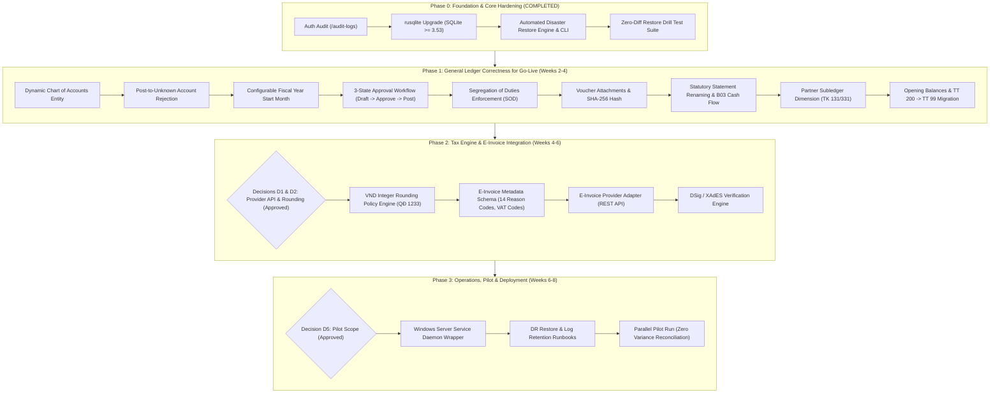

# Implementation & Delivery Plan: `money-flow`

**Product**: `money-flow` (VAS Enterprise Double-Entry Accounting Engine)  
**Methodology**: PLAN → TEST → DO → CHECK → DISTILL  
**Target Compliance**: TT 99/2025/TT-BTC, QĐ 1233/QĐ-CT, NĐ 174/2016/NĐ-CP, Luật Kế toán 2015  
**Updated**: 2026-11-23  

---

## 1. Current State Summary (Baseline Evidence)

1. **Test & Code Quality**: 256/256 tests passing across all suites (55 unit, 47 API, 149 E2E tiers 1–4, 5 property fuzzing with 1,100+ iterations), 0 Clippy warnings, 0 diffs in `cargo fmt` check `[FACT: cargo test, cargo clippy, commit a15226b]`.
2. **Double-Entry Invariants**: $\ge 2$ lines, single-sided, non-zero, zero-sum equilibrium ($\sum \text{Debits} == \sum \text{Credits} > 0$), strictly utilizing `rust_decimal::Decimal` (zero `f32`/`f64` floats) `[FACT: ledger.rs:77-138]`.
3. **Statutory 4-Step Closing**: Clears revenue deductions (TK 521), gross revenues (TK 511), expenses to TK 911, and net profit/loss to TK 4212; closed periods locked against retroactive edits `[FACT: closing.rs:47-270, db/period_repo.rs]`.
4. **Immutability & Identity**: SQLite triggers (`RAISE(ABORT)`) prevent raw SQL updates/deletes on `audit_logs`, `vouchers`, `voucher_lines`, and `idempotency_records`; server-derived JWT `sub` attribution `[FACT: db/schema.rs:200-260, auth.rs:80-120]`.
5. **Chart of Accounts & Disaster Recovery**: Dynamic Chart of Accounts CRUD with Cycle-Guard, Circular 99 statutory seed catalog (103 accounts), atomic restore engine, and dual-secret restore API/CLI verified by zero-diff tests `[FACT: db/account_repo.rs, db/disaster.rs, commit 715f26d]`.
6. **Architecture & Decomposition**: Decomposed into SOLID submodules strictly under 500 production lines (`db/`, `openapi/`, `catalog/`, `dto/`, `handlers/`) `[FACT: AGENTS.md §6, commit a15226b]`.
7. **Open Statutory & Operational Gaps**: 3-state approval workflow (G2), voucher attachments with SHA-256 (G5), opening balance migration (G1), statement of financial position/cash flows (G14), rounding engine (G6), and certified e-invoice provider integration (G7/G8) `[FACT: docs/plan/TASKS.md]`.

---

## 2. Phased Delivery Strategy



### Phase 0: Foundation & Core Hardening (Sprint 1 — Completed)
- **Entry Criteria**: Repository baseline established; initial unit test suite passing.
- **Exit Criteria**: Milestone M0 (Auth hardening, `rusqlite` upgrade, licenses) and Milestone M1 (Disaster recovery restore engine, CLI, zero-diff recovery drill) passing 100%.

### Phase 1: General Ledger Correctness for Go-Live (Sprint 2 — In Progress)
- **Entry Criteria**: Phase 0 complete; dynamic chart of accounts catalog populated.
- **Exit Criteria**:
  - Segregated approval workflow (`DRAFT` $\rightarrow$ `POSTED`) live; creators blocked from approving own vouchers (`403 Forbidden`).
  - Voucher attachments stored with validated SHA-256 hashes.
  - B01-DN (Statement of Financial Position) and B03-DN (Cash Flow) reports live.
  - TT 200 $\rightarrow$ TT 99 opening balances migration tool operational with verified 0-difference reconciliation.
  - Partner dimension (`partner_id`) enforced on TK 131/331.

### Phase 2: Tax Engine & E-Invoice Integration (Sprint 3)
- **Entry Criteria**: Phase 1 general ledger stable; Decisions D1 and D2 approved.
- **Exit Criteria**:
  - QĐ 1233 integer *đồng* rounding implemented with automatic GL residual balancing.
  - E-invoice metadata models (14 adjustment codes, 10 VAT rate codes) validated.
  - Certified e-invoice provider REST adapter functioning in sandbox environment.
  - Digital signature verification (XMLDSig/XAdES) verified against test certificates.

### Phase 3: Operations, Pilot & Deployment (Sprint 4)
- **Entry Criteria**: Phase 1 & 2 complete; Decision D5 approved.
- **Exit Criteria**:
  - Windows Server service daemon installer tested.
  - Comprehensive DR & 10-year log retention runbook published.
  - Historical parallel pilot run (Q3/Q4 2026 vouchers) executed with 0 VND balance variance.
  - Production Go/No-Go signoff.

---

## 3. Critical Path & Top 3 Delivery Risks

### Critical Path
```
P1-04 (Approval Workflow)
  └──> P1-05 (Segregation of Duties)
        └──> P1-06 (Voucher Attachments & Hash)
              └──> P1-08 (Opening Balance Migration)
                    └──> P2-01 (VND Rounding Engine)
                          └──> P2-03 (E-Invoice Provider Adapter)
                                └──> P3-03 (Parallel Pilot Run)
                                      └──> Production Go-Live
```

### Top 3 Delivery Risks & Mitigations

| # | Risk Description | Severity | Mitigation Strategy | Owner |
| :- | :--- | :---: | :--- | :--- |
| **R1** | **E-Invoice Provider API Delays / Contract Gaps**: Reliance on external provider (VNPT/Viettel/MISA) could slip past 01/01/2027 statutory deadline if credential provisioning is delayed. | **HIGH** | Build mock wiremock adapter adhering to provider specifications immediately; run contract tests in CI before sandbox keys arrive. | PO + Backend Lead |
| **R2** | **Opening Balance Reconciliation Discrepancies**: Historical client accounts under Circular 200 contain non-zero reconciliation deltas during automated mapping to Circular 99. | **HIGH** | Implement automated audit difference report identifying offending accounts prior to migration voucher posting. | BA + Chief Accountant |
| **R3** | **Windows Server Deployment Failure**: Binary running as a Windows service encounters unexpected file locking or environment path issues under production service accounts. | **MEDIUM** | Implement robust service control wrapper using `windows-service` crate and test on isolated Windows Server VM in Sprint 3. | Ops Lead |

---

## 4. Decision Gate Matrix

| Phase | Required Decision(s) | Status | Gate Resolution |
| :--- | :--- | :---: | :--- |
| **Phase 1** | **D4** (Partner Subledger on 131/331) | **APPROVED** | Gate passed: `partner_id` required on AR/AP lines. |
| **Phase 2** | **D1** (E-Invoice Provider vs In-House)<br>**D2** (VND Rounding Protocol) | **APPROVED** | Gate passed: Certified provider REST adapter selected; subtotal VAT rounding with GL balancing chosen. |
| **Phase 3** | **D5** (Pilot Scope & Protocol)<br>**D6** (Go-Live Target Date) | **APPROVED** | Gate passed: Single entity historical back-testing; go-live scheduled for 2026-12-31. |
