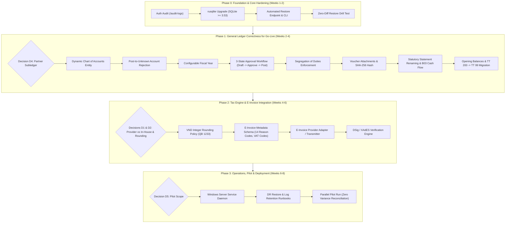

# Implementation & Delivery Plan: `money-flow`

**Product**: `money-flow` (VAS Enterprise Double-Entry Accounting Engine)  
**Methodology**: PLAN → TEST → DO → CHECK → DISTILL  
**Target Compliance**: TT 99/2025/TT-BTC, QĐ 1233/QĐ-CT, NĐ 174/2016/NĐ-CP, Luật Kế toán 2015  
**Updated**: 2026-11-23  

---

## 1. Current State Summary (Baseline Evidence)

1. **Test & Code Quality**: 88/88 tests passing (41 unit, 42 api, 5 property fuzzing with 1,100+ iterations), 0 Clippy warnings, clean `rustfmt` check `[FACT: cargo test, cargo clippy, commit 71795db]`.
2. **Double-Entry Invariants**: $\ge 2$ lines, single-sided, non-zero, zero-sum equilibrium ($\sum \text{Debits} == \sum \text{Credits} > 0$), strictly utilizing `rust_decimal::Decimal` (zero `f32`/`f64` floats) `[FACT: ledger.rs:77-138]`.
3. **Statutory 4-Step Closing**: Clears revenue deductions (TK 521), gross revenues (TK 511), expenses to TK 911, and net profit/loss to TK 4212; closed periods locked against retroactive edits `[FACT: closing.rs:47-270, database.rs:346]`.
4. **Immutability & Identity**: SQLite triggers (`RAISE(ABORT)`) prevent raw SQL updates/deletes on `audit_logs`, `vouchers`, `voucher_lines`, and `idempotency_records`; server-derived JWT `sub` attribution `[FACT: database.rs:203-255, auth.rs:80-120]`.
5. **Observability & Diagnostics**: Dual-sink non-blocking logging (`logs/money-flow.log.YYYY-MM-DD`), panic crash hooks (`logs/crash.log`), and persistent startup RCA diagnostics (`logs/startup_error.log`) `[FACT: diagnostics.rs:1-262]`.
6. **Open Statutory & Operational Gaps**: Dynamic chart of accounts table (G3), 3-state approval workflow (G2), opening balance reconciliation tool (G1), voucher attachments (G5), automated restore verification (G10), and e-invoice integration (G7/G8) `[FACT: DEV_STATUS.md]`.

---

## 2. Phased Delivery Strategy



### Phase 0: Foundation & Core Hardening (Sprint 1)
- **Objective**: Close infrastructure security gaps, upgrade embedded database engine, and establish verified recovery capabilities.
- **Entry Criteria**: Baseline commit `71795db` deployed on `main`; clean working tree.
- **Exit Criteria**:
  1. `/api/v1/audit-logs` restricted strictly to `Controller` and `Admin` roles.
  2. `rusqlite` upgraded with bundled SQLite version $\ge 3.53$ (verifying WAL-reset resilience).
  3. Automated restore endpoint (`POST /api/v1/system/restore`) and offline CLI tool implemented.
  4. Restore drill integration test passes, verifying 100% hash and trial balance equilibrium match.
  5. Formal open-source or proprietary `LICENSE` file committed at repository root.

### Phase 1: General Ledger Correctness for Go-Live (Sprint 2 & 3)
- **Objective**: Complete statutory general ledger compliance per Circular 99/2025/TT-BTC and Luật Kế toán 2015.
- **Entry Criteria**: Phase 0 exit criteria signed off; Decision D4 (Partner subledger scope) resolved.
- **Exit Criteria**:
  1. Dynamic `accounts` table active; posting vouchers to non-existent or inactive accounts is rejected with `422 UNKNOWN_ACCOUNT`.
  2. 3-state voucher approval workflow (`DRAFT` -> `APPROVED` -> `POSTED`) live; creators cannot approve their own vouchers (Segregation of Duties).
  3. Configurable fiscal year start date (supporting non-January 1 starts per TT 99 Điều 31).
  4. Voucher attachments linked with cryptographic SHA-256 integrity hashes.
  5. Balance sheet renamed to "Statement of Financial Position" (*Báo cáo tình hình tài chính*); Statement of Cash Flows (B03-DN) implemented.
  6. Opening balance migration tool converts TT 200 account balances to TT 99 with zero-diff reconciliation assertion.

### Phase 2: Tax Engine & E-Invoice Integration (Sprint 3 & 4)
- **Objective**: Implement tax calculation rules and e-invoice data components complying with QĐ 1233/QĐ-CT and NĐ 254/2026/NĐ-CP before the **01/01/2027** statutory deadline.
- **Entry Criteria**: STRICTLY GATED by Decision D1 (Build vs. Provider) and Decision D2 (Rounding method); Phase 1 complete.
- **Exit Criteria**:
  1. VND rounding policy rounds invoice totals to integer *đồng* per QĐ 1233 (trang 4) while maintaining exact decimal precision in general ledger accounts.
  2. E-invoice metadata fields (serial, template, invoice number, seller/buyer tax codes, 14 adjustment reason codes, 10 VAT rate codes) active.
  3. E-invoice integration verified against certified provider test environment (or GDT test receiver if D1 selects Option A).
  4. XMLDSig / XAdES digital signature verification engine operational.

### Phase 3: Enterprise Operations, Pilot & Deployment (Sprint 4 & 5)
- **Objective**: Package the engine for enterprise on-premise deployment and conduct an audit-grade parallel pilot run.
- **Entry Criteria**: Phase 1 and Phase 2 complete; Decision D5 (Pilot scope) signed off by CFO.
- **Exit Criteria**:
  1. Windows Server service wrapper (`windows-service` / `nssm`) and automated installation scripts verified.
  2. Disaster recovery runbook and log retention procedures documented.
  3. Pilot parallel run completed over 1+ fiscal quarters, proving 0-VND variance across all general ledger accounts against legacy accounting records.
  4. Final audit sign-off by Chief Accountant and CFO.

---

## 3. Critical Path & Key Risks

### 3.1 The Critical Path
$$\text{P0-01 (Auth Audit)} \rightarrow \text{P0-03 (Restore CLI)} \rightarrow \text{P1-01 (Dynamic COA)} \rightarrow \text{P1-04 (Approval Workflow)} \rightarrow \text{P1-08 (Opening Balances)} \rightarrow \text{Gate D1/D2} \rightarrow \text{P2-01 (Rounding)} \rightarrow \text{P2-03 (E-Invoice)} \rightarrow \text{P3-03 (Pilot Sign-off)}$$

### 3.2 Top 3 Delivery Risks & Mitigations

| Risk | Severity | Impact | Mitigation Strategy | Owner |
| :--- | :---: | :--- | :--- | :--- |
| **R1: E-Invoice 01/01/2027 Deadline Horizon** | **CRITICAL** | Failure to transmit e-invoices blocks commercial billing operations after statutory transition deadline. | Adopt **Decision D1 Option B** (integrate certified e-invoice provider REST API) for initial go-live. Defers in-house T-VAN XML engine to Phase 4. | PO + CFO |
| **R2: Monolithic `database.rs` Regression** | **HIGH** | `database.rs` is 2,447 lines; adding COA, attachments, and approval workflow risks breaking period locks or closing arithmetic. | Modularize `database.rs` into sub-repositories (`voucher_repo`, `account_repo`, `closing_repo`, `audit_repo`) using strict TDD. | Backend Lead |
| **R3: Opening Balance Disequilibrium (TT 200 $\rightarrow$ TT 99)** | **HIGH** | Account reclassifications in Circular 99 lead to trial balance disequilibrium during new fiscal year cutover. | Build an automated dual-entry reconciliation test asserting $\sum \text{Debits} == \sum \text{Credits}$ with exact 0-VND variance before unlocking live voucher posting. | Chief Accountant / BA Lead |

---

## 4. Decision Gate Matrix

| Phase | Blocked By Decisions | Condition to Start Phase | Consequence if Decision is Delayed |
| :--- | :--- | :--- | :--- |
| **Phase 0** | None | Immediate execution. | N/A |
| **Phase 1** | **D4** (Subledger Partner Dimension), **D6** (Go-Live Target) | D4 decides whether `partner_id` is added to `voucher_lines` now or deferred. | Schema changes deferred, risking breaking migration later. |
| **Phase 2** | **D1** (E-Invoice Build vs Provider), **D2** (Rounding Policy) | **STRICT BLOCKER**: No code or schema work for Phase 2 may start until D1 and D2 are resolved. | Cannot meet 2027-01-01 e-invoice statutory mandate. |
| **Phase 3** | **D5** (Pilot Scope & Parallel Run Protocol) | CFO approves pilot company and parallel test duration. | Deployment to production delayed. |

---

## 5. Lessons & Conventions for Coding Agents (for `AGENTS.md`)

```markdown
### Regulated Accounting Planning Rules
1. Zero Code Before Decision: Never write or modify e-invoice transmission or tax calculation code before Decision D1 (Build vs Provider) and Decision D2 (Rounding Method) are formally signed off.
2. Decimal Rigor: Every calculation touching money must strictly use rust_decimal::Decimal; any rounding change requires executing property-based fuzzing suites.
3. Immutability Protection: Never weaken, bypass, or delete SQLite immutability triggers (trg_audit_logs_*, trg_vouchers_*, trg_voucher_lines_*).
4. Statutory Terminology: Follow Circular 99 naming standards ("Statement of Financial Position" instead of "Balance Sheet").
5. Segregation of Duties: Creator of a voucher (JWT sub) must never be permitted to approve it.
6. Test-First Mandatory: Write failing unit/integration tests before touching persistence or business logic.
```

---

## 6. Discovered Technical Debt & Code References

1. **Monolithic Persistence Struct (`backend/src/database.rs:27-1500`)**:
   - `database.rs` contains 2,447 lines (1,500 prod lines). It mixes SQL DDL, schema migration, voucher persistence, closing voucher insertion, report calculation, idempotency replay, and audit logs. Needs decomposition into specialized sub-modules.
2. **Manual OpenAPI Construction (`backend/src/openapi.rs:1-1143`)**:
   - The OpenAPI 3.1 specification is hand-coded JSON instead of using derive macros (`utoipa`). This creates high drift risk when DTOs in `dto.rs` change.
3. **Missing Authentication on Audit Log Query (`backend/src/handlers.rs:323-335`)**:
   - `list_audit_logs_handler` extracts `_user: AuthenticatedUser`, allowing any role (including `Accountant`) to query audit logs. Must be upgraded to `RequireController` (restricted to Controller/Admin).
4. **Monolithic Integration Test Suite (`backend/tests/api_tests.rs:1-3138`)**:
   - 42 HTTP integration tests reside in a single 3,138-line file, increasing compile times (~20s per test build). Needs splitting into domain test files (`voucher_tests.rs`, `closing_tests.rs`, `auth_tests.rs`).
5. **No Database Restore Path (`backend/src/database.rs`)**:
   - Database has `backup()` using `VACUUM INTO`, but lacks any automated programmatic restore or verification logic.

